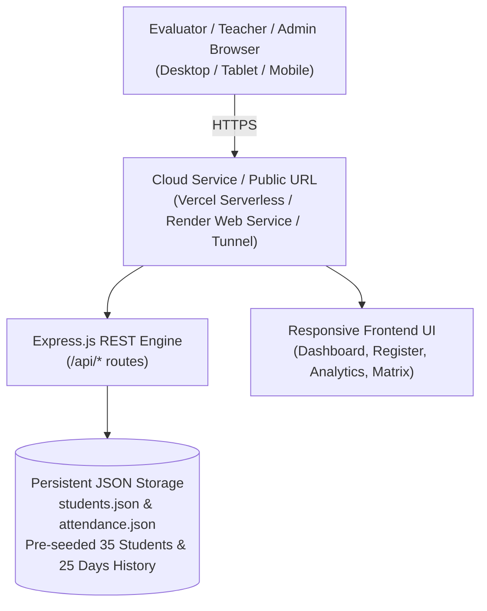

# 🎓 Student Attendance Management System — Cloud Deployment & Evaluator Guide

A complete institutional step-by-step guide to deploying the **Student Attendance Management System** (Node.js + Express + HTML5/CSS3/Vanilla JS + JSON Store) to **Vercel**, **Render**, **Docker**, and an **Instant 1-Click Live Cloud Tunnel** for college and school board evaluation.

---

## 🏛️ System Architecture



---

## ⚡ Option 1: Instant 1-Click Live Public Link (Recommended for Immediate Demo)

If you need a live public HTTPS link right now (within 5 seconds) to share with teachers, evaluators, or test on your phone:

1. Double-click **`launch-attendance-live.bat`** (in the root directory or inside `student-attendance-system/launch-live.bat`).
2. It starts the local server and spins up an authenticated **Cloudflare Public Tunnel**.
3. Look for the line in the terminal:
   ```text
   Your quick Tunnel has been created! Visit it at (it may take some moments to be ready):
   https://random-subdomain.trycloudflare.com
   ```
4. Copy that URL and open it on **any device anywhere in the world** — it is 100% live, secure (HTTPS), and interactive!

---

## ☁️ Option 2: Deploy to Vercel (100% Free, Zero Cold Starts)

Vercel hosts the application with serverless functions and CDN-delivered frontend assets.

### Step 1: Sign in to Vercel
1. Go to [https://vercel.com](https://vercel.com) and sign in with your GitHub account (**SurajYadav5**).

### Step 2: Import Git Repository
1. On your Vercel Dashboard, click **"Add New..."** ➔ **"Project"**.
2. Select your repository: **`SurajYadav5/HCL`**.

### Step 3: Configure Project Settings
1. In the **"Root Directory"** field, click **Edit** and select:
   ```
   student-attendance-system
   ```
2. **Framework Preset**: Select `Other` (or leave default).
3. **Build and Output Settings**:
   - Build Command: `npm run build` (or leave empty)
   - Output Directory: `public`
4. Click **Deploy**.

### Step 4: Verification
Vercel will build the serverless package and provide a public URL like:
`https://student-attendance-system-gamma.vercel.app`

---

## 🚀 Option 3: Deploy to Render (100% Free Cloud Web Service)

Render runs the Node.js Express server with persistent uptime.

### Step 1: Sign in to Render
1. Go to [https://render.com](https://render.com) and log in with your GitHub account (**SurajYadav5**).

### Step 2: Create Web Service
1. Click **"New +"** ➔ **"Web Service"**.
2. Connect your Git repository: **`SurajYadav5/HCL`**.

### Step 3: Service Configuration
Fill in the parameters:
- **Name**: `student-attendance-system`
- **Region**: `Oregon (US West)` or `Singapore`
- **Branch**: `main`
- **Root Directory**: `student-attendance-system`
- **Runtime**: `Node`
- **Build Command**: `npm install`
- **Start Command**: `node server/server.js`
- **Instance Type**: `Free`

### Step 4: Environment Variables
Add:
- `PORT` = `10000`

### Step 5: Click "Create Web Service"
Once the build completes, Render will show `Your service is live 🎉` at:
`https://student-attendance-system.onrender.com`

---

## 🐳 Option 4: Run with Docker & Docker Compose

### Single Docker Container:
```bash
cd student-attendance-system
docker build -t student-attendance .
docker run -p 5000:5000 student-attendance
```

### With Docker Compose (Runs along with PortfolioPro):
From the project root:
```bash
docker-compose up student-attendance
```
Access the application locally at: `http://localhost:5000`

---

## 📋 Evaluator Feature Walkthrough & Verification

When demonstrating the application to evaluators:

| Feature | Description | Verification URL / Location |
| :--- | :--- | :--- |
| **System Health API** | Live status & metadata | `/api/health` |
| **Dashboard Analytics** | Daily stats, attendance %, charts | **Dashboard** Tab |
| **Attendance Register** | Mark Present / Absent / Late / Half-Day | **Mark Attendance** Tab |
| **Defaulters Report** | Students below 75% attendance threshold | **Defaulters List** Tab |
| **Student Directory** | Student cards, guardian info, filters | **Students Directory** Tab |
| **Attendance Matrix** | Complete monthly table across dates | **Reports & Matrix** Tab |
| **Spreadsheet CSV Export** | Class 10 IT curriculum CSV export | Click **"Export CSV"** button |

